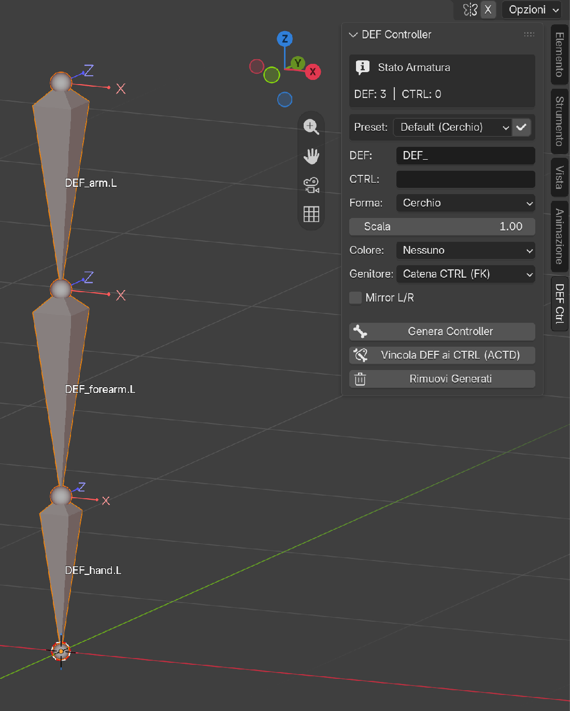
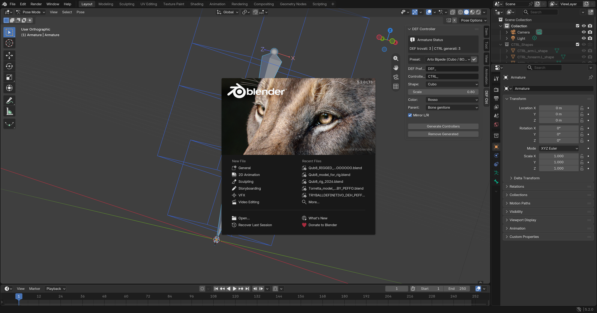
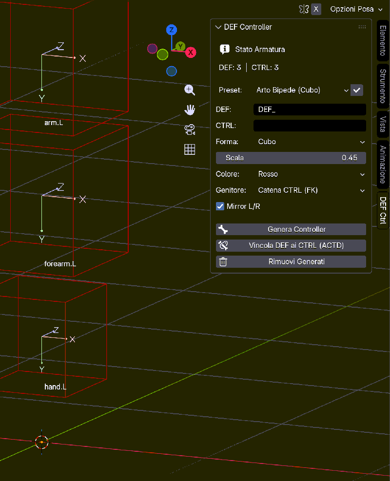

**[🇬🇧 English](README.md) | 🇮🇹 Italiano**

# CTRL_DEF — DEF Controller Auto

[](https://www.blender.org)
[](https://extensions.blender.org/)
[](https://github.com/PieroFra/def-controller-auto/releases)
[](LICENSE)
[](https://extensions.blender.org/add-ons/ctrl-def/)
[](https://hub.xerj.org/contributors/PieroFra)

Genera in un click bone controller tracciati, colorati e dotati di **custom shape condivise** a partire dalla catena di deformazione (`DEF_`), con gerarchia FK pulita, zero Dependency Cycle, package modulare `ctrl_def_mods\` (`v0.2.0`) e sinergia 1-click con **A.C.T.D.** (Auto Copy Transforms DEF).

| | |
|---|---|
| **Compatibilità** | **Blender 4.2 LTS — 5.2+** |
| **Categoria** | **Rigging** |
| **Versione** | **0.2.0** |
| **Autore** | **Pierfrancesco Diodato** |
| **Tipo** | Add-on (ZIP installabile o cartella) |
| **Licenza** | GPL-3.0-or-later |
| **Pagina ufficiale** | [Blender Extensions — ctrl-def](https://extensions.blender.org/add-ons/ctrl-def/) |

---

## ⚡ Quick Start (in meno di 60 secondi — 4 passaggi)

1. Seleziona l'armatura, entra in **Edit Mode** (`Tab`) e seleziona i bone con prefisso `DEF_`.
2. Apri la Sidebar (`N`) → scheda **DEF Ctrl** e scegli un preset (es. *Arto Bipede (Cubo)*) o personalizza forma/colore/scala.
3. Clicca **Genera Controller** (`ctrl_def.generate`): vengono creati i controller puliti (`hand.L`) in catena FK nella Bone Collection `"CTRLS"`.
4. Clicca **Vincola DEF ai CTRL (ACTD)** (`ctrl_def.bind_actd`): i bone `DEF_` copiano istantaneamente le trasformazioni dei controller in Pose Mode senza Dependency Cycle.

> **Risultato:** ruoti `arm.L` in Pose Mode e `DEF_arm.L` lo segue in tempo reale — la mesh si deforma tramite i DEF, il controllo passa dai controller.

---

## 🚀 Caratteristiche Principali

- **Naming pulito di default**: i controller si chiamano come i bone DEF senza prefisso (`DEF_hand.L` → `hand.L`, standard Blender/Rigify); con il campo *Prefisso Controller* si ottiene il naming classico (es. `CTRL_` → `CTRL_hand.L`).
- **Custom shape condivise per tipo** (`v0.1.2`): le forme wireframe sono oggetti condivisi (`CTRL_DEF_SHAPE_CIRCLE`, `CTRL_DEF_SHAPE_CUBE`, `CTRL_DEF_SHAPE_SPHERE`, `CTRL_DEF_SHAPE_ARROW`, `CTRL_DEF_SHAPE_CROSS`) — una sola mesh per tipo, riutilizzata da tutti i controller.
- **Generazione istantanea**: controller identici per posizione, orientamento e roll ai rispettivi `DEF_`, con `use_deform = False` (non deformano la mesh).
- **Gerarchia di default "Catena CTRL (FK)"**: ricrea l'albero FK tra i controller (`forearm.L` figlio di `arm.L`), rendendoli indipendenti dai DEF: **zero Dependency Cycle** con A.C.T.D., anche con parent `Root`.
- **Bone Collection dedicata**: isola automaticamente tutti i controller nella collezione `"CTRLS"` (rinominata da `"CTRL"` in `v0.2.0`).
- **Palette colori tematiche**: assegnazione rapida conforme al tema di Blender (Rosso, Verde, Blu).
- **Integrazione opzionale Bone Widget** (`v0.2.0`): i widget dei controller sono delegati all'estensione **Bone Widget** tramite `ctrl_def.create_widget` (selettore libreria integrato); senza estensione il pannello avvisa e offre il **link diretto** alla sua pagina.
- **Target IK rapido** (`v0.2.0`): `ctrl_def.add_ik` aggiunge un bone target IK (pole opzionale, `use_deform = False`) su una catena selezionata di 2‑3 controller, con zero Dependency Cycle con A.C.T.D.
- **Diagnostica Pre-Flight** (`v0.2.0`): `ctrl_def.diagnose` rileva bone `DEF` di lunghezza nulla, controparti specchiate `.L`/`.R` mancanti (con mirror attivo), collisioni di nome con bone non-DEF e avvisa quando si genera con parent `"DEF"` insieme ad A.C.T.D. (rischio Dependency Cycle).
- **Export JSON/CSV e Preset Utente** (`v0.2.0`): `ctrl_def.export_json` / `ctrl_def.export_csv` esportano il registro CTRL→DEF con i metadati del rig; `ctrl_def.save_preset` / `ctrl_def.load_preset` salvano e ricaricano le impostazioni del pannello su file `.json`.
- **Package modulare** (`v0.2.0`): la fonte di verità è il package `ctrl_def_mods\`, assemblato nel monolite installabile da `scripts/build_monolith.py` (build step, mai modificato a mano).
- **Interfaccia organizzata** (`v0.2.0`): il pannello è diviso in 3 sezioni collassabili — `1 · Setup`, `2 · Controller`, `3 · Avanzate` — più una **Guida** integrata (chiusa di default), tutte localizzate IT/EN incluse le intestazioni di sezione.
- **Parentela flessibile**: `Catena CTRL (FK)` (default), `Bone genitore`, `Root`, `Nessuno (Libero)` e `DEF stesso` — quest'ultimo **solo se i DEF non copiano i CTRL**, perché genera un Dependency Cycle con A.C.T.D.
- **Vincolo DEF→CTRL in 1 click**: il pulsante **"Vincola DEF ai CTRL (ACTD)"** (`ctrl_def.bind_actd`) entra in Pose Mode, configura ed esegue automaticamente **A.C.T.D.** se installato (sorgente = controller, destinazione = `DEF_`); senza A.C.T.D. applica gli stessi constraint `COPY_TRANSFORMS` in modo nativo (fallback standalone) dal registro proprietario.
- **Mirror L/R**: genera contemporaneamente la controparte specchiata (es. `.L` → `.R`), con preservazione dei separatori `_L`/`_R` nel mirror.
- **Preset rapidi**: *Default*, *Arto Bipede*, *Root Controller*, *Faccia*.
- **Interfaccia bilingue IT/EN**: tutte le etichette, i pannelli e le voci dei menu a tendina (`EnumProperty`) seguono la lingua della preferenza di Blender, con fallback automatico su inglese.
- **Registro JSON & rimozione pulita**: traccia ogni controller generato sull'armatura (`_ctrl_def_generated`), consentendo la rimozione totale e sicura (`ctrl_def.remove`) senza toccare il rig esistente.

---

## 📸 Anteprime (Screenshots & Demo GIF)

| File | Contenuto |
|---|---|
| `docs/images/01_before_def_bones.png` | Armatura con i bone `DEF_` selezionati e il pannello **DEF Ctrl** aperto nella Sidebar (`N`). |
| `docs/images/02_after_ctrl_generated.png` | Dopo **Genera Controller** con preset *Arto Bipede (Cubo/Rosso/Mirror)*: controller colorati in Pose Mode. |
| `docs/images/demo.gif` | Demo animata: onda di rotazione sulla catena di controller generati. |



*Figura 1 — Armatura con i bone `DEF_` selezionati (nomi e assi visibili) e il pannello **Controller DEF** aperto nella Sidebar (`N`) → scheda **DEF Ctrl**.*



*Figura 2 — Dopo **Genera Controller** con preset **Arto Bipede** (Cubo/Rosso/Mirror): forme personalizzate condivise colorate in Pose Mode e box di stato aggiornato (`DEF trovati: 3 | CTRL generati: 3`).*



*Figura 3 — Demo animata: onda di rotazione sulla catena di controller generati.*

---

## 🔄 Esempio Prima / Dopo (Nomi, Gerarchia e Attributi)

Catena di esempio (braccio sinistro) con preset *Arto Bipede (Cubo)*:

| Aspetto | Bone deformanti (prima) | Controller default (dopo) | Controller con prefisso opzionale (dopo) |
|---|---|---|---|
| **Nomi** | `DEF_arm.L` → `DEF_forearm.L` → `DEF_hand.L` | `arm.L` → `forearm.L` → `hand.L` | `CTRL_arm.L` → `CTRL_forearm.L` → `CTRL_hand.L` |
| **`use_deform`** | `True` | `False` | `False` |
| **Bone Collection** | — (rig originale) | `CTRLS` | `CTRLS` |
| **Custom shape** | — | `CTRL_DEF_SHAPE_CUBE` (condivisa) | `CTRL_DEF_SHAPE_CUBE` (condivisa) |
| **Gerarchia** | Catena deformazione | Catena FK (`forearm.L` figlio di `arm.L`) | Catena FK (`CTRL_forearm.L` figlio di `CTRL_arm.L`) |
| **Dependency Cycle con A.C.T.D.** | — | **Nessuno** | **Nessuno** |

I controller copiano posizione, orientamento e roll dei corrispondenti `DEF_`, ma non deformano la mesh (`use_deform = False`) e vivono nella Bone Collection dedicata `"CTRLS"`.

---

## 🔗 Sinergia con Auto Copy Transforms DEF (A.C.T.D.)

CTRL_DEF è il complemento naturale di **A.C.T.D.** (Auto Copy Transforms DEF):

1. Usa **CTRL_DEF** per creare i controller dell'armatura partendo dai bone `DEF_` (naming pulito, gerarchia FK, forme condivise).
2. Clicca il pulsante 1-click **"Vincola DEF ai CTRL (ACTD)"** (`ctrl_def.bind_actd`):
   - se **A.C.T.D.** è installato, CTRL_DEF entra in Pose Mode, ne configura le impostazioni (sorgente = controller, destinazione = `DEF_`) ed esegue la procedura automaticamente, senza intervento manuale;
   - in uso **standalone** (A.C.T.D. assente), applica gli stessi constraint `COPY_TRANSFORMS` in modo nativo, leggendo il registro proprietario dei controller generati.

I due addon operano in sinergia mantenendo registri e prefissi perfettamente isolati.

**Verifica empirica (Blender 5.2 LTS):** con il default *Catena CTRL (FK)* e con parent *Root*, Blender riporta **0 dependency cycle**; ruotando `arm.L` di 30° e `hand.L` di 20°, `DEF_arm.L` segue con delta 0.0000°. (Evitare la parentela *DEF stesso* insieme ad A.C.T.D.: genera cicli.)

**Repository A.C.T.D.:** https://github.com/PieroFra/auto-copy-transforms-def

---

## 🧪 Procedura di Test Headless

La suite `tests/test_ctrl_def.py` è eseguibile da terminale, su qualsiasi piattaforma, con ambiente Blender pulito (`--factory-startup`).

**Windows PowerShell:**

```powershell
powershell -NoProfile -ExecutionPolicy Bypass -File scripts/run_tests.ps1
```

**Linux / macOS / Bash:**

```bash
./scripts/run_tests.sh
```

**Comando diretto Blender (qualsiasi OS):**

```bash
blender --background --factory-startup --python scripts/run_ctrl_def_tests.py
```

I runner stampano il verdetto della suite: `VERDETTO: OK passati=<n> falliti=0 totale=<n>` (exit code 0) oppure `VERDETTO: FAIL ...` (exit code 1). Ultimo esito locale su Blender 5.2.0 LTS: `passati=5 falliti=0 totale=5` (vedi `tests/test_out.txt`).

---

## 📦 Creazione dello ZIP Installabile

Il pacchetto installabile per `v0.2.0` è il **package modulare**: il monolite generato più la cartella dei moduli `ctrl_def_mods\`, senza cartella contenitrice:

```
def_controller_auto_v0.2.0.zip
├── __init__.py              (monolite generato)
├── blender_manifest.toml
├── README.md
└── ctrl_def_mods\
    ├── __init__.py
    ├── ctrl_def_generation.py
    ├── ctrl_def_i18n.py
    ├── ctrl_def_main.py
    ├── ctrl_def_operators.py
    ├── ctrl_def_properties.py
    ├── ctrl_def_registry.py
    ├── ctrl_def_shapes.py
    └── ctrl_def_ui.py
```

Lo ZIP di release contiene tra i readme solo la versione inglese `README.md` (quella italiana vive nel repository); ogni archivio è accompagnato dal relativo file `.sha256` in `dist\`.

**In alternativa:** scarica direttamente il pacchetto (con file `.sha256` di verifica) dalla pagina [Releases](https://github.com/PieroFra/def-controller-auto/releases).

**Pagina ufficiale su Blender Extensions:** <https://extensions.blender.org/add-ons/ctrl-def/> — l'estensione è approvata e installabile direttamente da Blender 4.2+: *Modifica > Preferenze > Ottieni estensioni*, cerca **"DEF Controller Auto"** e clicca *Installa*.

**Installazione in Blender:** *Modifica > Preferenze > Componenti aggiuntivi > Installa da disco...*, seleziona lo ZIP (o la cartella estratta), attiva **DEF Controller Auto** e trova il pannello nella **Sidebar 3D (tasto `N`) → scheda "DEF Ctrl"**.

---

## 🧰 Riferimento Operatori

Tutti gli id operazione vivono nel namespace `ctrl_def.*` e sono raggiungibili anche tramite la ricerca *F3*. Etichette UI e descrizioni riportate corrispondono esattamente a quanto esposto dall'addon (localizzazione dinamica IT/EN):

| Operatore `bl_idname` | Etichetta UI (IT) | Descrizione (tooltip) |
|---|---|---|
| `ctrl_def.generate` | Genera Controller | Genera i bone controller nella collezione CTRLS a partire dai bone DEF selezionati |
| `ctrl_def.create_widget` | Crea Widget | Assegna il widget selezionato in Bone Widget ai controller generati |
| `ctrl_def.bind_actd` | Vincola DEF ai CTRL (ACTD) | Vincola i bone DEF ai controller generati tramite A.C.T.D. (se attivo) o constraint COPY_TRANSFORMS nativi |
| `ctrl_def.add_ik` | Aggiungi Target IK | Crea un bone target IK e un constraint IK sulla catena di 2-3 controller selezionata in Pose Mode |
| `ctrl_def.diagnose` | Diagnostica Rig | Controlla i bone DEF selezionati prima della generazione (zero-length, mirror mancanti, collisioni, cicli) |
| `ctrl_def.apply_preset` | Applica Preset | Applica il preset selezionato alle impostazioni del pannello |
| `ctrl_def.export_json` | Esporta JSON | Esporta la mappa CTRL->DEF dell'armatura attiva in formato JSON |
| `ctrl_def.export_csv` | Esporta CSV | Esporta la mappa CTRL->DEF dell'armatura attiva in formato CSV |
| `ctrl_def.save_preset` | Salva Preset JSON | Salva le impostazioni correnti del pannello in un file preset JSON |
| `ctrl_def.load_preset` | Carica Preset JSON | Carica le impostazioni del pannello da un file preset JSON |
| `ctrl_def.remove` | Rimuovi Generati | Rimuove i controller generati, gli eventuali target IK e i relativi constraint |

---

## ⚠️ Limitazioni Note e Roadmap (post `v0.2.0`)

- I workflow supportano le catene **FK**; l'IK è coperto dal target rapido su catene di 2‑3 controller (`ctrl_def.add_ik`), mentre lo **switch automatico IK/FK** è previsto per `v2`.
- I widget si appoggiano all'estensione opzionale **Bone Widget** (il pannello offre il link diretto di installazione): nessuna libreria di widget integrata.
- La verifica automatizzata copre generazione, naming, gerarchia FK, preset, bind A.C.T.D., target IK, diagnostica pre-flight, export JSON/CSV, preset utente e registro; la UI completa resta soggetta a verifica interattiva manuale.

---

## 📋 Changelog

### `v0.2.0`
- **Package modulare**: la fonte di verità è il package `ctrl_def_mods\` (9 moduli) assemblato nel monolite installabile da `scripts/build_monolith.py`.
- **Pannello ridisegnato**: 3 sezioni collassabili (`1 · Setup`, `2 · Controller`, `3 · Avanzate` — `3 · Advanced` in EN) più una `Guida` integrata in 5 passi.
- **Integrazione Bone Widget**: `ctrl_def.create_widget` delega la creazione dei widget all'estensione Bone Widget, con link diretto di installazione se assente.
- **Target IK rapido**: `ctrl_def.add_ik` sulle catene selezionate di 2‑3 controller (`use_deform = False`, zero Dependency Cycle).
- **Diagnostica Pre-Flight**: `ctrl_def.diagnose` (bone DEF di lunghezza nulla, specchiate `.L`/`.R` mancanti, collisioni di nome, avviso parent "DEF" con A.C.T.D.).
- **Export JSON/CSV e preset utente**: `ctrl_def.export_json`, `ctrl_def.export_csv`, `ctrl_def.save_preset`, `ctrl_def.load_preset` (round-trip testato).
- Orientamento delle custom shape (`shape_rot` → `custom_shape_rotation_euler`).
- Bone Collection dedicata ai controller rinominata `"CTRL"` → `"CTRLS"`.

### `v0.1.2`
- Custom shape condivise per tipo (`CTRL_DEF_SHAPE_*`): una sola mesh per forma, riutilizzata da tutti i controller.
- Localizzazione dinamica completa IT/EN: etichette, pannelli e pulsanti seguono la lingua di Blender, con fallback automatico su inglese (`tr()`).
- Localizzazione dinamica estesa anche ai **menu a tendina** (`EnumProperty`): forma, colore, parentela e preset usano callback `_items_*` che ritraducono le voci a ogni disegno del pannello.
- Scomposizione interna dell'operatore di generazione in funzioni helper (`_collect_def_bones`, `_create_ctrl_edit_bones`, `_assign_ctrl_parents`, `_configure_ctrl_pose_bones`) per un flusso più leggibile e verificabile.
- Etichette UI compatte senza troncamento IT/EN.
- Preservazione separatori `_L`/`_R` nel mirror.
- Script di test multipiattaforma (`scripts/run_tests.ps1` e `.sh`).
- Screenshot/GIF prive di splash screen.
- 10 nuovi test sui casi limite.

### `v0.1.1`
- Naming pulito senza prefisso di default.
- Gerarchia `Catena CTRL (FK)` a zero Dependency Cycle.
- Operatore 1-click `ctrl_def.bind_actd`.

### `v0.1.0`
- Release iniziale MVP.

---

## 📄 Licenza

GPL-3.0-or-later — vedi il file [LICENSE](LICENSE).
